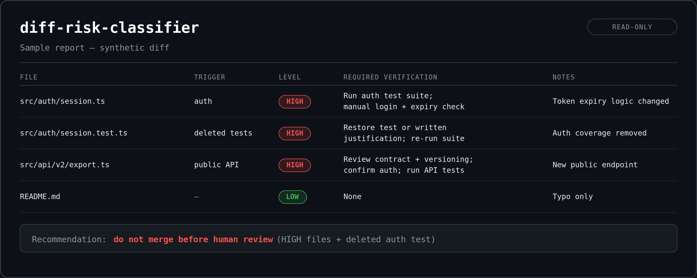

# diff-risk-classifier

Portable skill that classifies the merge risk of a diff — file by file —
before it gets merged. Read-only: it analyzes diffs and never modifies code.



## What it does

Given a pull request diff or `git diff`, it outputs:

- A risk table: `file | trigger | level | required verification | notes`
- A pre-merge verification checklist
- A merge recommendation: `merge` / `merge after verification` /
  `do not merge before human review`

Levels: **LOW** (no behavior change, fully reversible), **MEDIUM**
(contained, reversible, guarded), **HIGH** (irreversible, security,
data-loss, or unguarded). Touching auth, secret, or user data is HIGH
minimum. Plain config is MEDIUM — it rises to HIGH only when it changes
security-relevant behavior. Judge by what the value is, not where it
lives: a port number is config, an API key is secret.

## Installation

No build, no dependencies, no API key. Installing means copying one
folder (`diff-risk-classifier/`, containing only `SKILL.md`) into the
directory your agent reads skills from. Two things must stay intact, or
the agent may not pick the skill up:

- The folder name must stay `diff-risk-classifier`.
- `SKILL.md` must keep its frontmatter (`name` + `description`) — the
  description is what the agent matches your request against.

### 1. Get the skill

```bash
git clone https://github.com/Rafax01x/diff-risk-classifier
```

Or download the repo ZIP from GitHub and unzip it. You only need
`.agents/skills/diff-risk-classifier/` from it.

### 2. Copy it to your agent

Pick the row for your agent. `<your-project>` is the repo you want to
review diffs in. Project scope covers one repo (commit the folder and
your team gets it too); personal scope covers every project on your
machine.

| Agent | Project scope | Personal scope |
| --- | --- | --- |
| Claude Code | `<your-project>/.claude/skills/diff-risk-classifier/` | `~/.claude/skills/diff-risk-classifier/` |
| OpenAI Codex | `<your-project>/.agents/skills/diff-risk-classifier/` | `~/.agents/skills/diff-risk-classifier/` |
| Cursor | `<your-project>/.cursor/skills/diff-risk-classifier/` | `~/.cursor/skills/diff-risk-classifier/` |
| Gemini CLI, Copilot, other Agent Skills agents | `<your-project>/.agents/skills/diff-risk-classifier/` | `~/.agents/skills/diff-risk-classifier/` |

Example — Claude Code, personal (all projects):

```bash
cp -r diff-risk-classifier/.agents/skills/diff-risk-classifier ~/.claude/skills/
```

Example — Codex, one project:

```bash
cp -r diff-risk-classifier/.agents/skills/diff-risk-classifier <your-project>/.agents/skills/
```

The repo already ships the skill in the `.agents/skills/` layout, so for
Codex and other agents that read `.agents/skills/` natively, the copy is
a straight folder copy — nothing to convert. Cursor also picks up skills
from `.claude/skills/` and `.agents/skills/`, so one copy can serve
several agents.

### 3. Verify it loaded

Start a new agent session, then:

- Claude Code: type `/diff-risk-classifier` — the command should exist.
- Codex: open `/skills` or type `$diff-risk-classifier`.
- Any agent: ask it to review any small diff (see Usage). If you get the
  risk table + checklist + recommendation instead of a free-form review,
  the skill is active.

If it does not show up, restart the agent session and check the path
again — a wrong folder name or a missing `SKILL.md` is the usual cause
(see Troubleshooting).

### Updating

There is no auto-update. To update, `git pull` this repo and copy the
folder over the old one again.

## Usage

### Review a local diff

```bash
git diff main...HEAD --stat   # file list
git diff main...HEAD          # actual changes
```

Then ask your agent, for example:

```text
Review this diff with diff-risk-classifier. Do not modify code.
```

### Review a pull request

Give the agent the PR diff — paste the diff, or let the agent fetch it
with its own GitHub tools (for example `gh pr diff <number>` if it has
the GitHub CLI). Then ask the same thing: review it with
diff-risk-classifier, without modifying code.

### How it triggers

- Automatically: asking to review a PR or git diff matches the skill's
  description, so a compatible agent loads it on its own.
- Explicitly: Claude Code `/diff-risk-classifier`, Codex
  `$diff-risk-classifier`, or just name it in your message:
  "Use the diff-risk-classifier skill on this diff."

### What you get

- A risk table: `file | trigger | level | required verification | notes`
- A pre-merge verification checklist — each item must cite a test
  command + output, or a CI link, to count as checked
- A merge recommendation: `merge` / `merge after verification` /
  `do not merge before human review`

The recommendation is advisory — a human still decides. The skill never
modifies code, runs migrations, or installs dependencies, and it cannot
approve a merge on its own.

See [demo.md](demo.md) for a worked example, including a real PR
(JetBrains/thinkrail #1047) that motivated the config-vs-secret tuning.

## Troubleshooting

| Problem | Fix |
| --- | --- |
| Agent does not load the skill | Check the folder path for your agent (table above); the folder must be named `diff-risk-classifier` and contain `SKILL.md`; restart the session. |
| Agent gives a free-form review, not the table | Invoke it explicitly (`/diff-risk-classifier` or `$diff-risk-classifier`) or add "Use the diff-risk-classifier skill" to your message. |
| "Diff unavailable" / no file rows | The skill refuses to invent rows. Give the agent the actual diff (paste it, or make sure it can read the PR / working tree). |
| Agent wants to fix the code | Say "Do not modify code" — the skill analyzes only; fixing is a different task. |

## Layout

```text
.agents/skills/diff-risk-classifier/SKILL.md   # the skill
demo.md                                        # sample input + output
demo-output.png                                # sample report image (shown above)
README.md                                      # this file
```

## License

MIT. See [LICENSE](LICENSE).
